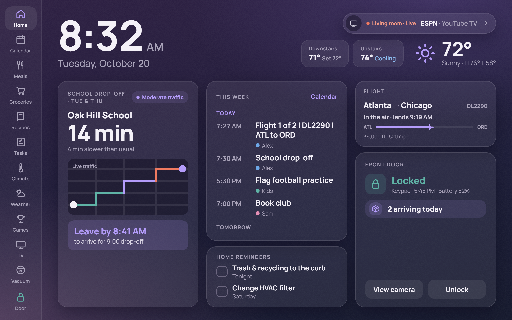

# Kitchen Hub

A wall-mounted kitchen display for the family, built on Home Assistant: clock and weather, the week's calendar, tonight's dinner and the meal plan, the school-run "leave by" time, the front door camera and lock, thermostats, the TV, the vacuum, game scores and flights. It's a small, fast web app (Preact) that Home Assistant serves to an Android tablet running Fully Kiosk Browser.



**Setting one up:**

1. [HARDWARE.md](HARDWARE.md): what to buy, the network, mounting and power, and the order to do things in.
2. [ha/README-ha-setup.md](ha/README-ha-setup.md): Home Assistant and each device.
3. [ha/README-tablet.md](ha/README-tablet.md): the hub on the tablet.

All names and data in this repo are sample data. Your own setup goes in `public/config.json`, which git ignores. See `HANDOFF.md` for the original spec, `design/` for the first prototype screens, and `screens/` for screenshots of the app in sample mode.

## Run it on your laptop

```bash
npm install
npm run dev
```

Open <http://localhost:5173/?mock=1>. In Chrome DevTools, use the device toolbar at **1280 × 800** to see exactly what the tablet will show.

Mock mode runs every screen on sample data. It turns on automatically when no Home Assistant URL is configured, or with `?mock=1`.
The small **Mock** button in the bottom-right corner opens test controls:

- **Ring the doorbell:** the Door screen takes over from any screen. Hold **Unlock** for a second to unlock. Add `?pinpad` for the PIN-pad version (`door.pin` in config.json): demo PIN `1234`, three wrong PINs lock the pad for 5 minutes.
- **Home card:** force the school drop-off, pick-up or dinner card.
- **Finish running timers in 3 s:** test the cook-timer alert without waiting.
- **Vacuum: Get stuck / Bin full:** see the vacuum warnings on Home and the Vacuum screen.
- **Show "Not connected" states:** see how every card looks when a device is offline.

### URL options

| Option | What it does |
|---|---|
| `?mock=1` | Use sample data |
| `?scene=dropoff\|pickup\|dinner` | Force the first Home card |
| `?now=2026-10-20T08:32` | Start the clock at this time (it keeps ticking) |
| `?nodev=1` | Hide the Mock button |

Screens are hash routes: `#/`, `#/calendar`, `#/meals`, `#/groceries`, `#/recipes`, `#/tasks`, `#/climate`, `#/games`, `#/tv`, `#/vacuum`, `#/door`, `#/cook/<recipe-id>?step=4`.

## Checks

```bash
npm test
```

```bash
npm run test:e2e
```

```bash
npm run build && npm run size
```

- `npm test`: unit tests for the meal rules, timer parsing, school-run logic and ingredient matching.
- `npm run test:e2e`: Playwright opens every screen at 1280 × 800 in mock mode, exercises the controls, and saves screenshots to `tests/__screenshots__/` for comparison with `screens/`.
- `npm run size`: production build, then checks the JS stays under 100 KB gzipped.

## Layout

```
src/
  app.tsx            shell: rail, router, doorbell takeover, overlays
  screens/           Home, Door, Cook, Meals, Recipes, Calendar, Climate, Tasks, TV
  components/        Rail, Icon, Checkbox, Toggle, overlays, mock dev panel
  data/adapter.ts    DataAdapter interface (every read and action)
  data/mock-adapter.ts, mock-data.ts
  logic/             pure, unit-tested: mealRules, timers, schoolRun, ingredients, time
  config.ts          loads config.json at runtime
  cookTimers.ts      timers that survive step and screen changes
public/config.example.json
```

